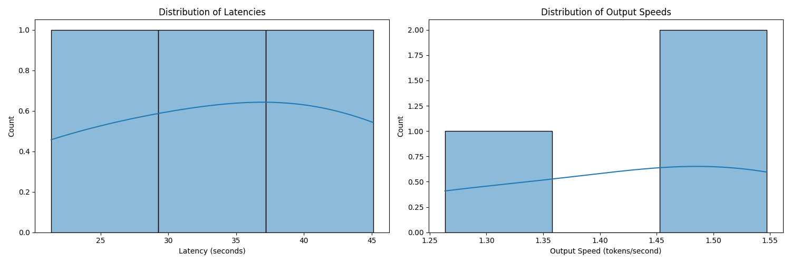
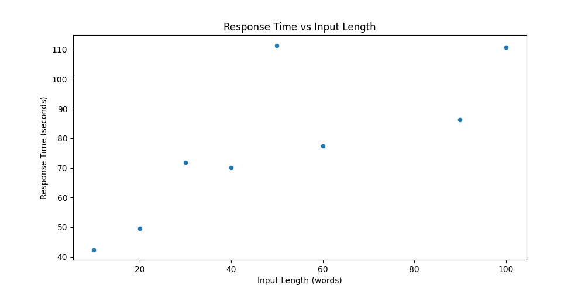
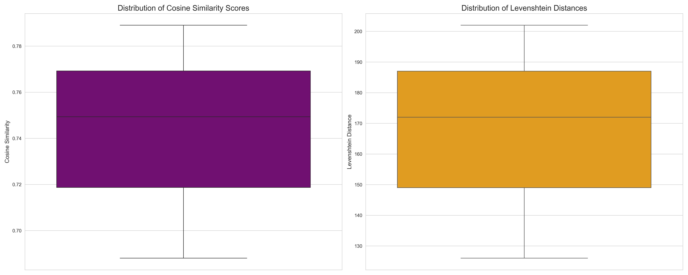

# Historical exploratory measurements

These numbers are retained from the original experiment. They are not current
performance or language-quality benchmarks. The original run date, raw request
results, model revision and generation settings were not committed.

| Reported value | What the script measures |
|---|---|
| Mean latency: 31.61 s | Successful full endpoint requests in a three-case English experiment |
| Reported speed: 1.54 tokens/s | DistilBERT token count for `response1`, divided by full endpoint latency |
| Mean cosine similarity: 0.74 | Mean-pooled DistilBERT similarity to one English reference per case |
| Mean edit distance: 166.67 | Character edit distance to those references |
| Load mean: 72.47 s | Successful requests only, from 20 tasks using five worker threads |
| Load p95 | Not reported; the script recorded too few successful samples |

## Interpretation limits

- The reported speed is not model decoding throughput. Endpoint time includes
  generation of other outputs that the numerator does not count.
- The load test did not run 20 simultaneous workers. It omits failed/timed-out
  requests from latency summaries and does not report a success rate.
- Requests omit session IDs and share the legacy conversation. They do not
  measure independent users.
- The current API does not consume the script's `input_text` field. The
  input-length plot therefore does not establish an input-length effect.
- Similarity and edit distance do not establish translation correctness,
  proficiency fit, speech quality or learning gains.

Do not use these figures to compare current versions. The optional legacy
`evaluate.py` still requires services, additional packages and model/NLTK
downloads. It is not part of CI. For a model-free application check, use
[`scripts/benchmark_local.py`](scripts/benchmark_local.py) and the
[synthetic benchmark report](reports/synthetic-api-20261018.md).

## Original plots and reported hardware

The plots remain for provenance and have the same limitations described above.

Reported hardware: ARM, eight cores/eight threads, 8 GB RAM, Darwin 23.3.0.
