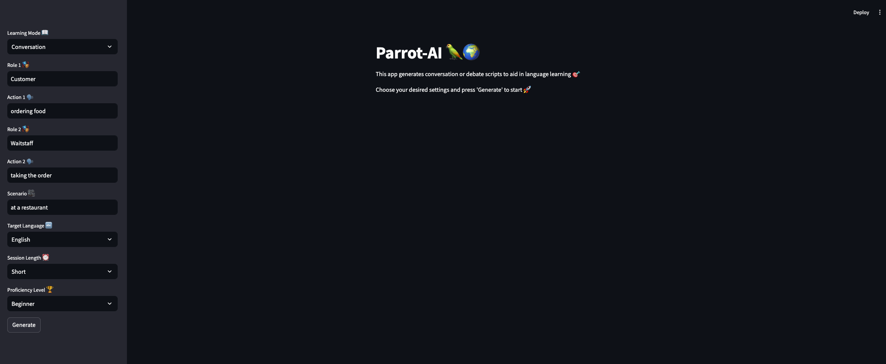

# Parrot AI

Generate two-person conversations and debates for language practice, with English
translations and learning points. Choose English, Hindi, German, Spanish, or
French, a proficiency level, and a short or long session.

The Streamlit interface calls a FastAPI backend, which uses an OpenAI-compatible
local model server. No paid API key is required. **Play audio uses Google
Text-to-Speech (gTTS): it needs internet access and sends the selected text to
Google.** Conversation generation and translation use the configured model server.



[Watch the original demo](https://youtu.be/XQmrTN0QzQQ). Screenshots and the demo
show the original interface; current labels may differ.

## Engineering focus

The application connects configurable role prompts, translations and learning
points through a local model API. Session isolation, bounded requests and clear
failure states support repeatable practice. The models and frameworks are
third-party components; language quality and learner outcomes remain unmeasured.

For example, choose German, Beginner and Conversation. Set a café scenario with
customer and barista roles, generate an exchange, then inspect the translations
and learning points. This describes the workflow, not guaranteed model quality.

## Run locally

Requires Python 3.12 and a running OpenAI-compatible model server, such as
[llamafile](https://github.com/Mozilla-Ocho/llamafile). Model weights are downloaded
separately; check their license and hardware requirements. The original demo used
Mistral Instruct 7B.

```sh
git clone https://github.com/mrinoybanerjee/parrot-ai.git
cd parrot-ai
python3.12 -m venv .venv
source .venv/bin/activate
python -m pip install -r backend/requirements.txt -r frontend/requirements.txt
```

Start the model server on port 8080, then run these in separate terminals from
the repository root, with the virtual environment active:

```sh
LLM_SERVER=http://localhost:8080 uvicorn backend.app:app --host 127.0.0.1 --port 8000
```

```sh
BACKEND_SERVER=http://localhost:8000 streamlit run frontend/app.py --server.address 127.0.0.1
```

Open `http://localhost:8501`. Choose Conversation or Debate, fill in the roles or
topic, then select Generate. Translate to English shows translations; Play audio
uses the online service described above. API documentation is at
`http://localhost:8000/docs`.

## Docker

On Docker Desktop for macOS/Windows, start the host model server on port 8080
with a listen address reachable from Docker (`host.docker.internal`). Restrict
access using your host firewall; the application has no authentication. Then:

```sh
docker compose up --build backend frontend
```

The web interface and backend ports are published on loopback only. On Linux,
configure `host.docker.internal` or change `LLM_SERVER` to a reachable model host
in `docker-compose.yml`.

## Tests

```sh
python -m pip install -r tests/requirements.txt
python -m pytest --cov=backend --cov=frontend --cov-report=term-missing
```

Or run `docker compose run --rm --no-deps test` after building the test
image with `docker compose build test`. Tests use synthetic requests and mocked
model/audio services; no model server, model download, or paid API is needed.
The CI workflow is configured to run these tests and build the containers. It does not publish images,
deploy production services, or run live model evaluations.

## Architecture and limits

```text
Browser → Streamlit → FastAPI → local model server
              └── Play audio → Google TTS
```

- Streamlit assigns each browser session a random `X-Session-ID`; generation,
  summary and reset use the same ID. API clients should supply their own random
  16–64 character alphanumeric/hyphen ID. Clients without the header share the
  legacy default conversation.
- Conversations live in memory in one backend process. Use one worker. Restarting
  the backend loses them; sessions expire after an hour of inactivity, and the
  backend accepts at most 128 active sessions. Local inference is serialized. A busy backend returns after five seconds rather
  than leaving requests queued indefinitely.
- This is a local learning prototype with no login or durable history. Session
  IDs are isolation tokens, not user authentication. Do not expose it publicly
  or use sensitive text. Model correctness and language quality need human review.
- Model calls and frontend requests have timeouts. A failed conversation step
  clears that backend conversation so a retry cannot continue partial history.
- Changing settings starts a new conversation; Generate clears prior learning
  points. Existing generated text remains in the browser session until replaced.

## Evaluation

[EVALUATION_RESULTS.md](EVALUATION_RESULTS.md) retains historical exploratory
results and their methodology limits. Its reported speed is not model decoding
throughput, and its load test used five workers, not 20. `evaluate.py` is an optional manual experiment
requiring running services, additional packages from `requirements.txt`, and
model/NLTK downloads. It is not part of the normal setup or test suite. Unit tests
do not establish translation accuracy, speech quality, throughput, or production
readiness.

The [model-free API benchmark](reports/synthetic-api-20261018.md) uses a loopback
fake model and the real API/SDK. It checks synthetic session separation and
failure handling; its timings do not include model inference or the browser.

## Project layout

| Path | Purpose |
|---|---|
| `backend/` | FastAPI endpoints, role prompts, model interaction |
| `frontend/` | Streamlit settings, conversation display, audio |
| `tests/` | Mocked API, chatbot and interface regressions |
| `assets/` | Original screenshots and evaluation plots |
| `evaluate.py` | Optional live evaluation script |

MIT — see [LICENSE](LICENSE). Built with [Streamlit](https://streamlit.io/),
[FastAPI](https://fastapi.tiangolo.com/), the OpenAI Python client, and
[llamafile](https://github.com/Mozilla-Ocho/llamafile).
