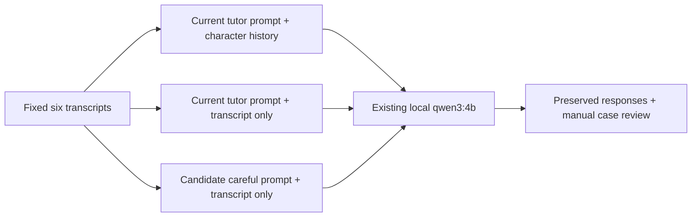

# Local teaching diagnostic — October 18, 2026

**Learning summaries are unverified model output. They can confidently teach false rules.**
Use them for practice with independent checking, not as an answer key.
This is a small English diagnostic, not a language-quality benchmark.

## Question and fixed examples

The earlier runtime check reported advice that rejected “an apple” and the
uncontracted “you are welcome”. Both are valid English. Before changing prompts,
we fixed six synthetic cases and their expected distinctions in
[the fixture](../data/teaching-diagnostic-v1.json). No learner or user data was used.

| Case | Expected distinction |
|---|---|
| Observed apple transcript | “one apple” and “an apple” are valid; contractions are optional |
| Valid article and contraction | Preserve “I would like an apple” and “You are welcome” |
| Standard past tense | In standard written English, correct bare “seen” to “saw” with “yesterday” |
| Singular they | Preserve singular “they are”; do not invent gender or require tense backshift |
| Chicken | Meat and a whole bird allow different article choices; context is missing |
| School | Attendance and a particular destination allow different article choices |

Ground truth and scenario descriptions are evaluation context, not extra summary
instructions. The summary receives only its existing instruction and the labeled
utterances. We assessed factual accuracy, fidelity to those utterances, and useful
teaching. A confident false rule fails accuracy. A truncated answer cannot pass the
whole case, even if its visible part is correct. No aggregate quality percentage
is reported.

## Setup and requests

- Base: `13c076f9d87d5517f2becb8c1ca44fde9168e51b`.
- Existing Ollama 0.34.4 local model: `qwen3:4b`, Q4_K_M, 4B; digest
  `359d7dd4bcdab3d86b87d73ac27966f4dbb9f5efdfcc75d34a8764a09474fae7`.
- Apple M4, 16 GiB RAM; macOS 26.6.2; Python 3.12.12.
- Loopback `127.0.0.1:11434` only. No model download, paid API, audio service,
  microphone, camera, or other device permission.

The [production replay](teaching-production-repro.json) captured the actual
`DualChatbot.summary()` messages and called the existing model through the OpenAI
SDK with production decoding defaults. It finished normally in 33.99 seconds.
It **did not reproduce the exact article/contraction error**. It did incorrectly
label “I'd like” as “Present simple tense”, and made unsupported absolute claims
about polite phrases. One successful replay does not invalidate the earlier failure.

The controlled comparison used the same six cases in three conditions:



All controlled conditions used native Ollama `/api/chat`, seed 53, temperature 0,
`num_predict=1200`, and requested `think=false`. This differs from production's
SDK/default decoding. The server still returned planning text with a literal
`</think>` in some responses. We preserved it; the comparison grades the final
teaching portion after that delimiter. This is diagnostic handling, not a change
to the application's parser. A fixed seed does not establish general determinism.

An initial SDK trial with a 900-token limit ended at `length`. Its saved result is
[inconclusive](teaching-inconclusive-sdk-v1.json); the next call was interrupted.
We did not count either as a passing teaching answer. The final controlled output
is [here](teaching-controlled-v1.json), including exact messages, finish reasons,
model metadata, and the fixture hash.

## Results

All 18 requests returned responses: 11 ended at `stop`, 7 at `length`.
These are completion counts, not correctness scores. `I` means the answer was
truncated and cannot pass overall. Concrete failures in visible final teaching
text remain evidence even when the whole answer is inconclusive.

| Fixed case | Current prompt + history | Current prompt, transcript only | Careful prompt, transcript only |
|---|---|---|---|
| Observed apple | False tense label for “I'd like” | False restrictions on responses to thanks | Valid phrases preserved; rigid wording remains ambiguous |
| Valid article/contraction | Valid forms preserved; wrong explanation of responding to a request | Valid forms preserved; same pragmatic error | I: barely began the final answer |
| Standard past tense | I: correct target; bad paraphrase | Correct target; overbroad tense rule | I: correct target; overbroad tense rule |
| Singular they | Target preserved | I: target preserved in partial answer | I: only quoted the sentence |
| Chicken | Invented context and false countability rule | False correction of a valid mass-noun order | I: both forms preserved, but false menu/article rule |
| School | Both forms accepted; explanation is limited | Invented context and false correction | I: invented context and false correction |

Representative final-answer evidence:

- Current/history apple calls “I'd like” **“Simple present for requests”**. It is
  a modal construction with *would*, not simple present.
- Transcript-only apple says **“never say ‘no problem’ or ‘it’s nothing’”** after
  thanks. These are possible responses; beginner guidance does not make them wrong.
- Current/history past paraphrases “I saw her yesterday” as **“I met her last day”**.
  That changes the meaning and gives learners an unnatural time phrase.
- Transcript-only chicken labels **“I ordered chicken”** **“Incorrect for beginners”**
  and lists **“chicken, pizza, milk”** as countable food items. The mass-noun reading
  is valid; milk is not generally countable in this sense.
- Careful/past says **“always use the simple past tense ... for actions that happened
  before now”**. For example, “I was working yesterday” is also valid. The supplied
  *seen → saw* correction is useful, but this universal rule is false.
- Careful/chicken advises **“For food items on menus, add ‘a’ if you mean one dish”**.
  Ordering a portion of chicken does not require “a chicken”. The summary guesses
  what each speaker means rather than keeping the missing context explicit.
- Careful/school says **“the Waitstaff is stating a general habit (not a specific
  school)”** and calls its change **“a grammatical correction”**. The input does
  not establish that intent. Both supplied phrases can be grammatical.

The careful apple answer says all supplied phrases are valid. That is a useful
improvement in this case. Its claim that no register choices exist “here” is too
ambiguous to count as a definite false correction. We do not infer a general
improvement from it. The careful condition's five truncated answers also limit
what this fixed-budget comparison can establish.

## Attribution and change decision

- **Model selection:** the earlier integration fix permits `LLM_MODEL=qwen3:4b`.
  These requests used that installed model. We did not compare models or download
  the demo's Mistral weights, so this does not establish which model would teach best.
- **Parsing:** the production SDK response itself contains incorrect advice before
  the app's only cleanup, replacing `</s>` and trimming whitespace. That cleanup
  cannot create the observed false grammar rules. There is no grammar validator.
- **History:** the current summary duplicates the first character's replies as
  prior assistant messages, then supplies the full transcript. The comparison
  removes that history to test this potential source of confusion. False teaching
  rules remain without it, so history duplication is not a sufficient explanation.
- **Prompt:** the candidate asks for evidence, valid alternatives, optional register,
  and uncertainty. It preserves some valid phrases, but still invents context and
  gives false rules. Truncation prevents a complete usefulness assessment.

**Decision:** leave production prompts, history, and public APIs unchanged. This
small experiment did not establish a dependable fix. Publish the limitation and
reproduction evidence rather than promise reliable teaching. This does not prove
that better prompts or another model cannot help. It means that improvement was
not established under these controls.

A next quality pass needs reviewed examples with explicit context, separate
holdout cases, more than one decoding run, and multilingual checks. Any candidate
must preserve valid alternatives and avoid new false corrections before adoption.

## Reproduce without downloads

Use the existing Python 3.12 environment with the project's runtime requirements.
The script refuses to pull a model, uses a fixed loopback URL, disables proxy use,
and refuses to overwrite an existing output file.

```sh
python scripts/diagnose_teaching.py --production-repro --output /tmp/parrot-production-new.json
python scripts/diagnose_teaching.py --output /tmp/parrot-controlled-new.json
python -m pytest --cov=backend --cov=frontend --cov-report=term-missing
```

The existing model-free suite passed: **27 tests, 90% coverage**. Those tests check
integration and state behavior; they do not verify linguistic correctness.
The small, artificial examples are not representative learner conversations.
Manual assessment is not an expert linguistic evaluation. No learner outcomes,
multilingual teaching, translation accuracy, or model-to-model
comparison were measured.
